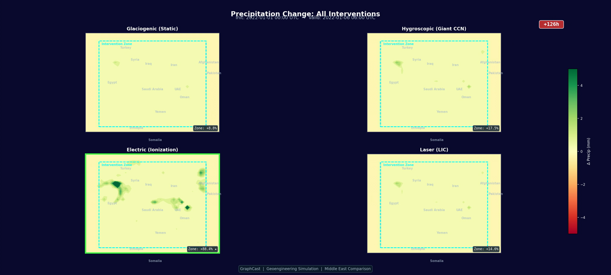
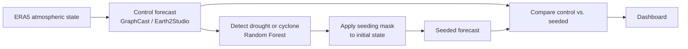

# Morro

**Forecast droughts and tropical cyclones, simulate cloud-seeding interventions, and find the one that works best before the disaster arrives.**

🥇 **1st Place, Sustainability Track · TreeHacks 2026** (Stanford)

[Live demo](https://graphcastdeploy.vercel.app/) · [Devpost](https://devpost.com/software/morro) · [Demo video](https://youtu.be/BBR3-OXCjtU)



<sub>Precipitation change 126 hours after seeding, for each of the four methods, over a Middle East drought. Electric ionization (green border) had the largest effect.</sub>

## What it does

Morro is a simulator for the people who would decide on local weather interventions: drought agencies, meteorological bodies, and environmental regulators. Starting from the current state of the atmosphere, it:

1. **Forecasts 10 days ahead** with two AI weather models, Google DeepMind's GraphCast and NVIDIA Earth2Studio. Both start from ERA5 reanalysis states (40+ variables across pressure levels on a 1° grid).
2. **Detects the threat.** Random Forest classifiers trained on ERA5 estimate drought and heat-dome severity with the Composite Drought Severity Index, and detect tropical-depression formation from pressure fields.
3. **Simulates four seeding methods** (electric ionization, glaciogenic/silver iodide, hygroscopic/giant CCN, and laser-induced condensation) and ranks them by how much they help.

In the Middle East drought scenario above, electric-ionization seeding increased precipitation by 16%.

## How it works



Each intervention is a **physics-calibrated perturbation mask**: an additive change to the model's initial atmospheric state, scaled to the dose and to current conditions using thermodynamic relationships. The weather models are autoregressive. Each takes two starting snapshots (now and 6 hours earlier) and predicts forward in 6-hour steps on a 40K+ node global mesh, so the perturbation carries through the full 10-day rollout. Comparing the seeded rollout with the control rollout shows the intervention's effect, region by region.

## Repo layout

| Path | Contents |
|---|---|
| [`treehacks/`](treehacks) | The Morro pipeline: seeding masks (`geoengineering_masks.py`), GraphCast integration (`graphcast_geoengineering.py`), Earth2Studio pipeline (`climate_intervention.py`), drought detection and analysis |
| [`climate-intervention-dashboard/`](climate-intervention-dashboard) | Next.js dashboard comparing control and seeded forecasts, deployed on Vercel |
| `run_graphcast_10day.py`, `run_graphcast_small.py` | Run GraphCast forecasts from ERA5 sample data |
| `drought_detector.py`, `drought_map.py`, `extreme_drought_map.py` | Drought classification and maps built from forecast output |
| [`graphcast/`](graphcast), `setup.py` | Google DeepMind's GraphCast package, included unmodified |

## Running it

```bash
# Python pipeline
pip install -e .        # installs DeepMind's graphcast package and its JAX dependencies
pip install scikit-learn joblib cartopy shapely google-cloud-storage earth2studio

python run_graphcast_10day.py                          # 10-day forecast; downloads weights and ERA5 sample data from Google Cloud
python drought_detector.py predictions_10day_real.nc   # classify drought severity
cd treehacks && python graphcast_geoengineering.py --help   # run seeding interventions over a lat/lon box
```

```bash
# Dashboard (Node.js 24 and pnpm 10.13.1)
cd climate-intervention-dashboard
pnpm install --frozen-lockfile
pnpm dev
```

Run `pnpm lint`, `pnpm typecheck`, and `pnpm build` from the dashboard directory before deploying.

## Built with

Python · JAX · GraphCast · NVIDIA Earth2Studio · xarray · scikit-learn · Next.js · Tailwind · Vercel

## Team

Built at TreeHacks 2026 by Thaarak Sriram, Tej Kosaraju, and Kieran P.

## Credits and license

Built on [GraphCast](https://github.com/google-deepmind/graphcast) by Google DeepMind. Their `graphcast/` package is included unmodified under the Apache 2.0 license, and this repository uses the same [license](LICENSE). GraphCast model weights and ERA5 data come with their own terms of use; see DeepMind's repository for details.
